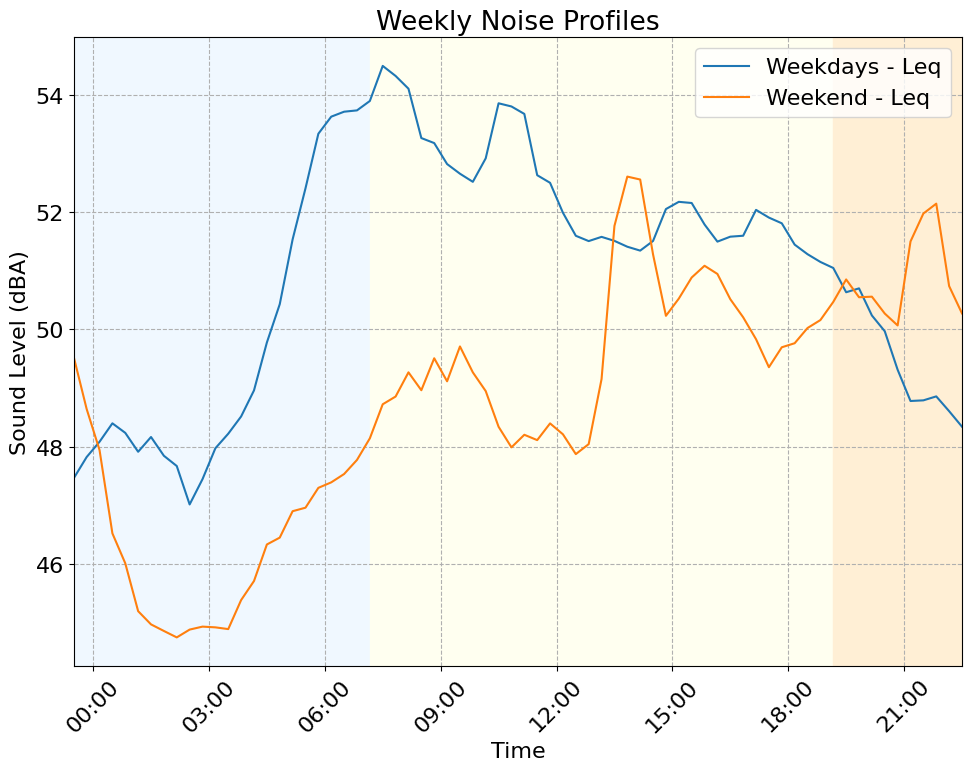
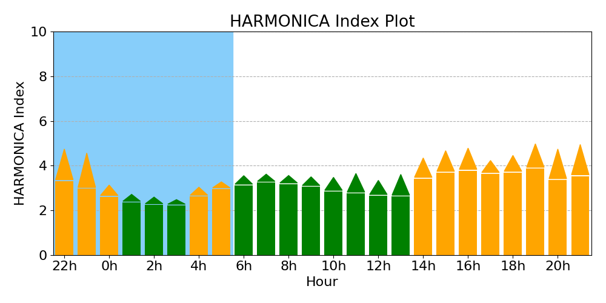

# noisemonitor

A python package for sound level data analysis. 

[](https://pypi.python.org/pypi/noisemonitor)
[](https://anaconda.org/conda-forge/noisemonitor)
[](https://github.com/valerianF/noisemonitor/blob/main/LICENSE)
[](https://doi.org/10.5281/zenodo.24572668)

**Documentation:** [Usage Guide](https://github.com/valerianF/noisemonitor/blob/main/docs/usage.md) · [API Reference](https://github.com/valerianF/noisemonitor/blob/main/docs/api.md) · [Migration Guide](https://github.com/valerianF/noisemonitor/blob/main/docs/migration.md) · [Changelog](https://github.com/valerianF/noisemonitor/blob/main/docs/CHANGELOG.md)

**⚠️ Version 1.1.0:** most indicators are now validated against external reference data, and several fixes change computed values. If you upgrade from 1.0.x, read the Changelog first. Code written for versions before 1.0.0 needs the Migration Guide.

## Table of Contents

- [Key Features](#key-features)
- [Installation](#installation)
- [Quick Start](#quick-start)
- [Core Modules](#core-modules)
- [Software Testing and Validation](#software-testing-and-validation)
- [Citation](#citation)
- [Dependencies](#dependencies)
- [License](#license)
- [Disclaimer](#disclaimer)
- [Use of AI tools](#use-of-ai-tools)

## Key Features

- **Acoustic indicators** - Implements standard ($L_{eq}$, $L_{den}$, $L_{90}$, etc.) and research-based noise indicators (HARMONICA, Number of Noise Events, low-frequency criteria from third-octave bands, etc.)
- **Flexible data loading** - CSV, Excel and TXT files (also compressed), with automatic detection of dates, separators and decimal commas
- **Two analysis modes** - Summary indicators (discrete values) and profile indicators (time series)
- **Multiprocessing support** - Fast processing of large datasets
- **Easy visualization** - Built-in plotting functions with customizable styles
- **Data coverage validation** - Automated quality checks with configurable thresholds
- **Weather integration** - [Canada only] Merge and analyze data with Canadian weather station data
- **Validated with external data** - As of v1.1.0 release, most indicators have been validated against independent datasets and reference implementations (see [Software Testing and Validation](#software-testing-and-validation)).

## Installation

### Using PyPI
```bash
pip install noisemonitor
```

For weather integration (Canada only)
```bash
pip install noisemonitor[weather]
```

If you want to install the latest development version:
```bash
pip install git+https://github.com/valerianF/noisemonitor
```

### Using Anaconda

Anaconda users can install using `conda-forge`:
```bash
conda install -c conda-forge noisemonitor
```


## Quick Start

**noisemonitor** is designed for flexibility and ease of use. All analysis functions accept an optional `column` parameter, allowing you to specify which data column to analyze (e.g., to work with datasets containing multiple sound level measurements or frequency bands). Most functions return results as pandas DataFrames for easy manipulation.

```python
import noisemonitor as nm

# Load data
df_1m = nm.load(
    'tests/data/internal/test_data_laeq1m.csv',
    datetimeindex=0, # Column index for datetime
    valueindexes=1,  # Column index(es) for sound levels
    header=0,        # Header row index
    sep=','
)

# Compute Lden
lden = nm.summary.lden(df_1m)
lden.head()
```

| Lden | Lday  | Levening | Lnight |
|------|-------|----------|--------|
| 56.1 | 51.75 | 50.09    | 49.22  |

```python
# Compute weekly profiles
weekday_profile = nm.profile.periodic(
    df_1m,
    hour1=23,
    hour2=22,
    day1='monday',
    day2='friday',
    win=3600,    # 1-hour window
    step=1200    # 20-minute step
)

weekend_profile = nm.profile.periodic(
    df_1m,
    hour1=23,
    hour2=22,
    day1='saturday',
    day2='sunday',
    win=3600,
    step=1200
)

# Visualize
nm.display.compare(
    [weekday_profile, weekend_profile],
    ['Weekday', 'Weekend'],
    'Leq',
    fill_background=True,
    title='Weekly Noise Profiles'
)
```



```python
# Load 1 s data and compute HARMONICA indexes (requires data at 1 s or finer)
df_1s = nm.load(
    'tests/data/internal/test_data_laeq1s.csv.xz',
    datetimeindex=0,
    valueindexes=1
)
harmonica = nm.summary.harmonica_periodic(df_1s)
nm.display.harmonica(harmonica) # Visualize
```



## Core Modules

### `nm.load()`
Load data from CSV, Excel, or TXT files (or a list of files) onto a regular time grid, with automatic datetime parsing.

```python
df = nm.load('data.csv', datetimeindex=0, valueindexes=1, header=0, sep=',')
```

### `nm.filter`
Filter data by datetime, remove outliers, or filter by weather conditions.

```python
df_filtered = nm.filter.extreme_values(df, min_value=30, max_value=100)
```

### `nm.summary`
Compute discrete sound level indicators: $L_{eq}$, $L_{den}$, HARMONICA, frequency analysis, low-frequency criteria, histograms, etc.

```python
overall_lden = nm.summary.lden(df)
daily_lden = nm.summary.periodic(df, freq='D')
harmonica = nm.summary.harmonica_periodic(df)
# df_freq: one column per frequency band (e.g., one-third-octave band levels)
freq_summary = nm.summary.freq_periodic(df_freq, freq='D')
lowfreq = nm.summary.lf_periodic(df_freq, freq='D', method=['botsford', 'montano'])
```

### `nm.profile`
Compute time-varying sound level profiles: time series, daily/weekly patterns, number of noise events, etc.

```python
time_series = nm.profile.series(df, win=3600, step=1200)
weekday_profile = nm.profile.periodic(df, hour1=0, hour2=23, day1='monday', day2='friday', win=3600)
nne_profile = nm.profile.nne(df, hour1=0, hour2=24, background_type='L50', exceedance=5)
lowfreq_series = nm.profile.lf_series(df_freq, method='montano', win=3600)
```

### `nm.display`
Visualize results with line plots, heatmaps, and more.

```python
nm.display.line(time_series, 'Leq', 'L10', 'L90', title='Noise Levels')
nm.display.compare([weekday_profile, weekend_profile], ['Weekdays', 'Weekend'], 'Leq')
nm.display.freq_map(freq_summary['Leq'], title='Frequency Heatmap')
```

### `nm.weather` (Canada only)
Integrate Environment Canada weather data to analyze weather impact on noise.

```python
stations = nm.weather.weathercan.get_historical_stations(coordinates=[45.5, -73.6], radius=25)
df_weather = await nm.weather.weathercan.merge_weather(df, station_id='702S006',  # climate ID
                                                       wind_speed_flag=18,
                                                       timezone='America/Toronto')  # weather times are LST
contingency = nm.weather.weathercan.contingency_weather_flags(df_weather)
```

## Software Testing and Validation

**noisemonitor** is tested with pytest on every pull request and push to the main branch. Each indicator has one of three validation statuses:
- **External**: $L_{eq}$, $L_n$, $L_{den}$, HARMONICA, Number of Noise Events and two low-frequency criteria match reference values computed outside the package (Clark et al., 2021; Bruitparif; Baclet & Rumpler, 2024; Montano & Gushiken, 2023; Generalitat de Catalunya, 2012).
- **Derived**: weekly and monthly periods, other windows, frequency-band functions, day counts and TNI apply these validated computations and are tested against them.
- **Definition only**: NPL, roughness indicators and the Botsford low-frequency criterion, for which no published reference values were found, are tested against their definitions.

Other tests check behaviour on edge cases (data gaps, daylight saving time, sub-second data, file formats). See [Software testing and external validation](https://github.com/valerianF/noisemonitor/blob/main/docs/usage.md#software-testing-and-external-validation) in the Usage Guide for the status of each function, the datasets and the tolerances.

## Citation

If you use **noisemonitor**, please consider citing us:

```bibtex
@inproceedings{fraisse2023noisemonitor,
    title={noisemonitor: A Python Package For Sound Level Monitor Analysis},
    author={Fraisse, Valérian},
    booktitle={Acoustics Week in Canada},
    year={2023}
}
```

## Dependencies

Python 3.9 or later, with:
- **NumPy** ([numpy.org](https://numpy.org/)), **pandas** 2.2 or later ([pandas.pydata.org](https://pandas.pydata.org/)) and **Matplotlib** ([matplotlib.org](https://matplotlib.org/));
- **python-calamine** and **openpyxl**, to read Excel files;
- for weather integration only (`noisemonitor[weather]`): **requests**, **aiohttp**, **lxml** and **python-dateutil**.

## License

This project is licensed under the Apache License 2.0 - see the [LICENSE](https://github.com/valerianF/noisemonitor/blob/main/LICENSE) file for details.

## Disclaimer

**noisemonitor** is an analysis tool: its results have no legal value on their own. Comparing them with noise limits or regulations requires measurements made according to the applicable local standards (location, duration, instrumentation), and an assessment by a qualified acoustician. Decisions to exclude data (e.g., weather filtering) should also be made by a qualified acoustician. The software is provided "as is", without warranty of any kind (see the License).

## Use of AI tools

AI coding assistants have been used in the development of **noisemonitor** since version 1.0.0. Version 1.1.0 was developed with Claude Opus 5.5 (Anthropic), used through Claude Code, for:
- reviewing the code for bugs and inconsistencies;
- drafting code changes, tests and documentation for the fixes and features I specified;
- preparing the validation data and comparing the package's results with the external reference values;
- checking definitions and conventions against the cited literature and standards.

I set the scope, made every choice of definition and convention, and reviewed every change before committing it. The reference values used for validation come from the external sources cited above, not from AI. I remain responsible for the package's content.
